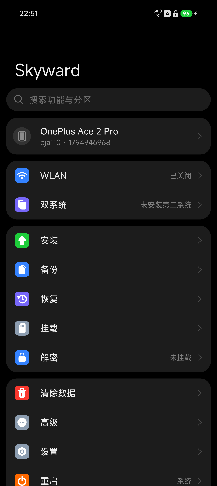
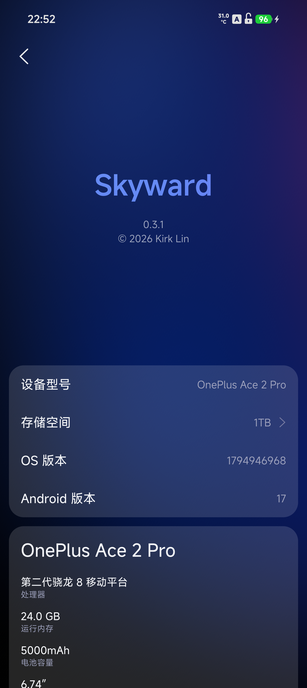
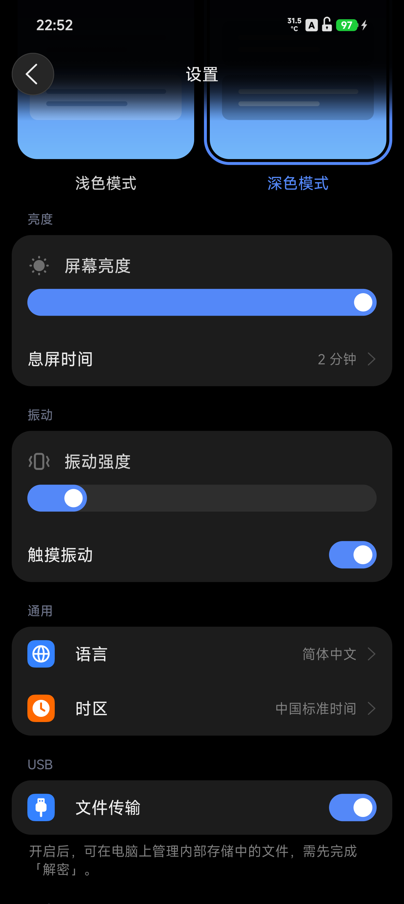
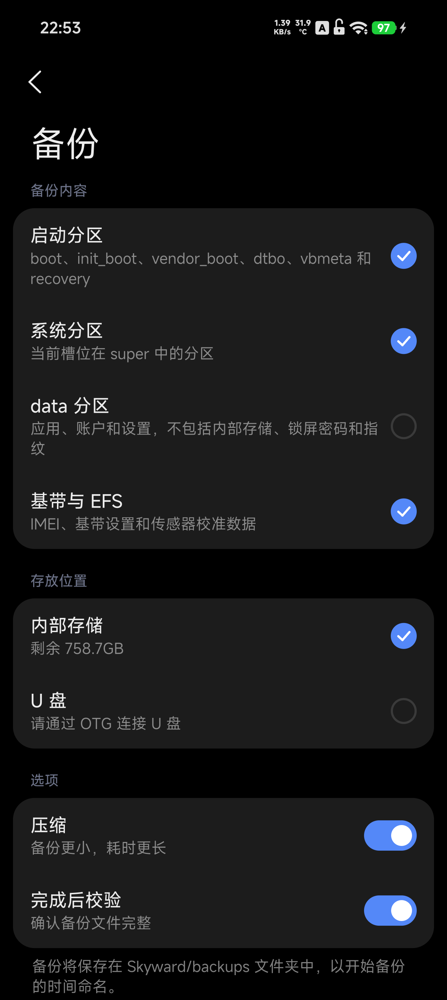

# Skyward Recovery for OnePlus Ace 2 Pro (PJA110)

[简体中文](README.zh-CN.md) · [Downloads](https://github.com/zhangquanjie/skyward/releases) · [Port notes](PJA110-PORT.md) · [Changelog](CHANGELOG.md)

An unofficial Skyward Recovery port for the **OnePlus Ace 2 Pro (PJA110)**, adapted and device-tested on **crDroid Android 17**. This repository focuses on the PJA110 port, its paired `vendor_boot`, and an OTA-survival Magisk module.

> This is not a universal recovery image. Flash only on PJA110 and only with the matching ROM baseline. The recovery and paired `vendor_boot` must be used together.



## Current tested release

Baseline: `crDroidAndroid-17.0-20261118-xigua-v13.1`, kernel `5.15.223-g68fc396ad5e5`.

| File | Purpose | SHA-256 |
| --- | --- | --- |
| `skyward-v0.3.1-pja110-crDroid-Android17-20261118.img` | Skyward recovery | `3df9d55f70cfe3c124a361bd2ec3f8b875ea22361931aa652eeab975a2ac5813` |
| `vendor_boot-20261118-recovery-fixed.img` | Required paired vendor_boot | `17fea4f1054fd5f33a10412e87130d3a125ce711574edc78ef88ffb485038787` |
| `skyward-pja110-ota-survival-20261118.zip` | Optional Magisk OTA-survival module | `41cd145c33005d1775325184ccbf4a5fad32622b00873bd78e0fc03a377b7518` |

[Download the 20261118 release](https://github.com/zhangquanjie/skyward/releases/tag/pja110-crDroid-Android17-v0.3.1-20261118)

## Verified on-device

- Display initialization and 120 Hz AA536 panel output
- Synaptics S3910 touch
- Data decryption
- ADB and read/write MTP switching
- Wi-Fi scan, association, DHCP, and internet access
- Backup interface and normal Skyward operation

<table>
  <tr>
    <td></td>
    <td></td>
    <td></td>
  </tr>
</table>

## Installation

Back up important data and confirm the current slot before flashing. Example for slot A:

```text
fastboot getvar current-slot
fastboot flash recovery_a skyward-v0.3.1-pja110-crDroid-Android17-20261118.img
fastboot flash vendor_boot_a vendor_boot-20261118-recovery-fixed.img
fastboot reboot recovery
```

Replace `_a` with `_b` when the active target is slot B. Keep a known-working image for the other slot until the new pair is verified.

For future OTAs, install `skyward-pja110-ota-survival-20261118.zip` in Magisk. It patches the **new active slot's own vendor_boot** only when its stock module list is recognized, then restores the paired recovery. It deliberately refuses unknown OTA layouts instead of copying an old vendor_boot across kernel versions. See [PJA110-PORT.md](PJA110-PORT.md) for details.

## Development

The device-specific wrapper is in [`devices/pja110/recovery`](devices/pja110/recovery), the reproducible repack scripts are in [`scripts`](scripts), and the Magisk module source is in [`magisk/skyward-pja110-survival`](magisk/skyward-pja110-survival). Firmware-derived images and proprietary kernel modules are distributed only as release assets.

Skyward is originally created by [kirklin](https://github.com/kirklin/skyward). This PJA110 adaptation remains licensed under GPL-3.0-or-later.
