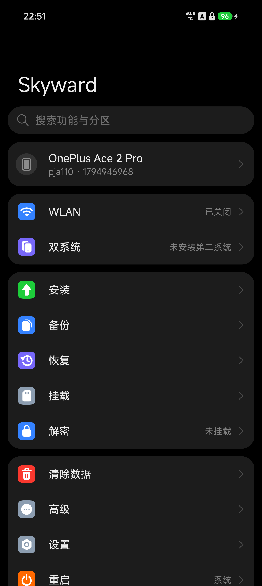
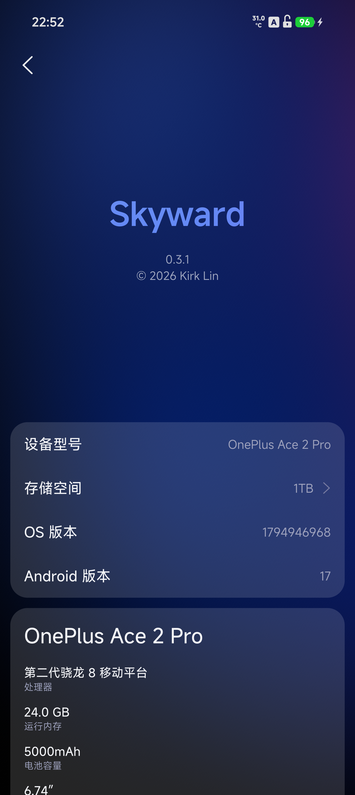
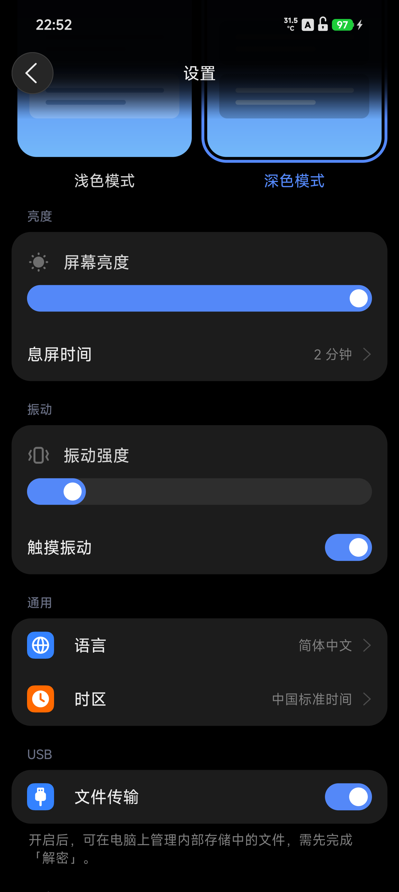
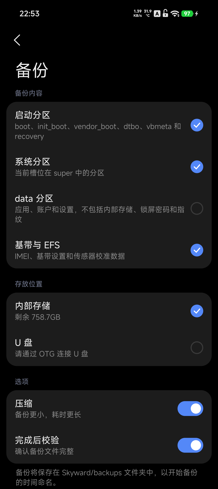

# 一加 Ace 2 Pro（PJA110）Skyward Recovery

[English](README.md) · [下载](https://github.com/zhangquanjie/skyward/releases) · [适配说明](PJA110-PORT.md) · [更新日志](CHANGELOG.md)

这是为 **一加 Ace 2 Pro（PJA110）**适配并经过真机验证的第三方 Skyward Recovery。目前主要面向 **crDroid Android 17**，仓库同时维护 Recovery、与之配套的 `vendor_boot` 修复，以及 OTA 后自动恢复的 Magisk 模块。

> 这不是通用 Recovery。仅限 PJA110，且必须匹配对应 ROM 基线；Recovery 与配对的 `vendor_boot` 必须一起使用。



## 当前真机验证版本

系统基线：`crDroidAndroid-17.0-20261118-xigua-v13.1`；内核：`5.15.223-g68fc396ad5e5`。

| 文件 | 用途 | SHA-256 |
| --- | --- | --- |
| `skyward-v0.3.1-pja110-crDroid-Android17-20261118.img` | Skyward Recovery | `3df9d55f70cfe3c124a361bd2ec3f8b875ea22361931aa652eeab975a2ac5813` |
| `vendor_boot-20261118-recovery-fixed.img` | 必须配套刷入的 vendor_boot | `17fea4f1054fd5f33a10412e87130d3a125ce711574edc78ef88ffb485038787` |
| `skyward-pja110-ota-survival-20261118.zip` | 可选的 OTA 生存 Magisk 模块 | `41cd145c33005d1775325184ccbf4a5fad32622b00873bd78e0fc03a377b7518` |

[下载 20261118 版本](https://github.com/zhangquanjie/skyward/releases/tag/pja110-crDroid-Android17-v0.3.1-20261118)

## 已验证功能

- AA536 屏幕正常点亮并以 120 Hz 工作
- Synaptics S3910 触摸正常
- Data 解密正常
- ADB 与可读写 MTP 切换正常
- Wi-Fi 扫描、连接、DHCP 与联网正常
- 备份界面及 Skyward 常用功能正常

<table>
  <tr>
    <td></td>
    <td></td>
    <td></td>
  </tr>
</table>

## 刷入方法

请先备份重要数据，并确认当前槽位。当前槽位为 A 时示例：

```text
fastboot getvar current-slot
fastboot flash recovery_a skyward-v0.3.1-pja110-crDroid-Android17-20261118.img
fastboot flash vendor_boot_a vendor_boot-20261118-recovery-fixed.img
fastboot reboot recovery
```

当前槽位为 B 时把 `_a` 改成 `_b`。在新组合确认可启动前，建议另一槽位保留已知可用的回退镜像。

后续 OTA 可在 Magisk 中安装 `skyward-pja110-ota-survival-20261118.zip`。模块只会处理**更新后当前槽位自己的新 vendor_boot**：识别到已知原版模块列表后修正加载顺序，再恢复配套 Recovery；如果 OTA 改变了未知布局，模块会主动拒绝修改，绝不会把旧内核版本的 vendor_boot 复制到新系统。原理与故障处理见 [PJA110-PORT.md](PJA110-PORT.md)。

## 开发与致谢

机型专用启动包装脚本位于 [`devices/pja110/recovery`](devices/pja110/recovery)，可复现的重打包脚本位于 [`scripts`](scripts)，Magisk 模块源码位于 [`magisk/skyward-pja110-survival`](magisk/skyward-pja110-survival)。固件衍生镜像与专有内核模块不进入 Git 历史，只作为 Release 附件发布。

Skyward 原项目由 [kirklin](https://github.com/kirklin/skyward) 创建。本 PJA110 适配继续遵循 GPL-3.0-or-later。
